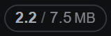
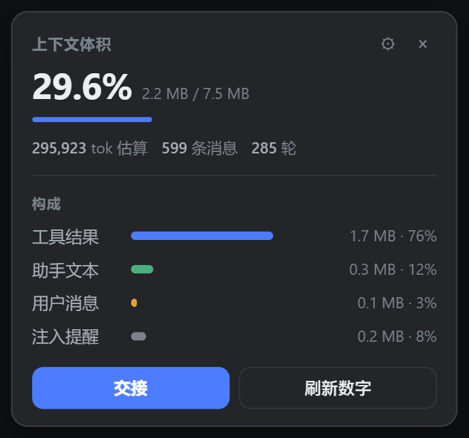
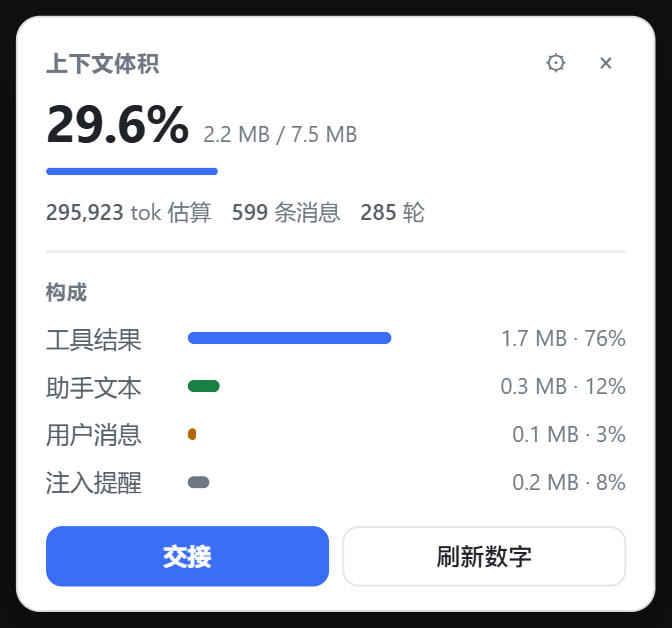

# 上下文看门（dsh-context-ruler）

在每条回答的动作行里显示当前会话的上下文体积，越过阈值时变色并提示交接；点一下「交接」，写好交接文档、新建会话，并把「先读交接文档」的指令停在输入框里等你确认。



## 它解决什么

长会话会膨胀到发不出去：历史越攒越厚，最后一次请求的 payload 超过服务端的判定线，发送前直接 413，且 `retryable=false`——会话就此报废。

这个插件把「离判定线还有多远」摆在回答旁边，让你在撞墙之前换会话。

## 它量的是什么

`coreBytes` = 当前会话所有待发送消息的文本部分 UTF-8 字节数之和，包含工具调用参数、工具结果、注入的提醒；图片按 `attachment.bytes × 4/3` 估算。

- **判定线** = `上下文窗口 × bytesPerToken`，默认 `7.5 B/token`。
- **上下文窗口**：默认自动取当前模型的真实窗口（宿主 `tokenMeter` 记录的路由容量）；取不到时回退到配置里的 `contextWindow`（默认 `750000`）。也可以在设置里取消「自动」，手填一个窗口值来模拟更小的判定线。
- **显示**：十进制 MB（`bytes / 1e6`，保留 1 位小数），超过 1024 MB 才切 GB，数字旁永远带分母。
- **百分比** = `coreBytes / 判定线`；**估算 tokens** = `coreBytes / bytesPerToken`。

口径和「发不出去」的那一次是同一条：数字过 100% 就是会被拒发的那一档。

## 在界面上的样子

- 徽标长这样：`3.2 / 5.6 MB`，落在每条回答下方的动作行里（复制、点赞、`用量` 那一排）。
- **悬停**：只读面板，看构成（工具结果 / 助手文本 / 用户消息 / 注入提醒）。
- **点击**：钉住面板。里面有 `⚙` 设置、`交接`、`刷新数字`；点面板外面就收起。
- **越线**：过 `warnRatio`（默认 60%）变黄、过 `dangerRatio`（默认 85%）变红，并弹一条界面气泡「建议交接」。气泡是 DOM，不是会话消息，不会进上下文；点「稍后」按会话和级别记住。

| 暗色 | 亮色 |
| --- | --- |
|  |  |

界面颜色全部取自宿主主题令牌（`--dsw-alias-*` / `--dsw-specific-*`），跟随 DSH 的亮暗模式和主题，不写死颜色。

## 交接

点「交接」之后：

1. 宿主把交接文档写到 `<工作目录>/_交付/交接_YYYY-MM-DD_HHmm.md`，内容含目标、最近对话摘录、从工具调用里提取的关键路径，以及已完成 / 未完成 / 下一步的骨架。
2. 新建一个同工作目录的会话。
3. 把这段指令预填进输入框，**不自动发送**：

```
接着上一个会话继续。先读交接文档：<绝对路径>
读完后用一句话复述「要做什么、从哪继续」，等我确认再动手。
```

## 零 token，不阻断

插件只做本地计算：宿主读 `session.deriveMessages()`，客户端通过本地 HTTP（`/context-guard/api/*`）取数字。

- 不注入消息、不调模型、不读上游；
- 不拦截发送、不自动压缩、不自动切会话；
- 关掉插件后，DSH 的行为和装之前完全一样。

## 安装

```sh
# 从市场条目所在的仓库安装
dsh plugin add pcysanji/dsh-context-ruler

# 或者从 npm
dsh plugin add dsh-context-ruler
```

也可以在 DSH 的插件市场里搜 `上下文看门` / `dsh-context-ruler` 一键安装。

## 配置

大部分项可以直接在面板里点 `⚙` 改，保存后立即生效；也可以编辑 `$DSH_HOME/context-guard/config.json`（Windows 默认 `%USERPROFILE%\.dsh\context-guard\config.json`）。

| 键 | 默认 | 说明 |
| --- | --- | --- |
| `enabled` | `true` | 总开关，关掉后插件完全不出现在界面上 |
| `showBadge` | `true` | 只关显示，保留后台计算 |
| `showAlerts` | `true` | 只关越线气泡，保留变色 |
| `autoLimit` | `true` | 自动按当前模型的上下文窗口算判定线 |
| `contextWindow` | `750000` | 手动窗口（`autoLimit` 关闭时生效） |
| `bytesPerToken` | `7.5` | 每 token 的字节估算 |
| `warnRatio` | `0.6` | 变黄阈值 |
| `dangerRatio` | `0.85` | 变红阈值 |
| `refreshEveryTurns` | `25` | 后台重算的最少回合间隔；悬停/点击总是立即重算 |
| `handoffDir` | `_交付` | 交接文档目录（相对工作目录） |
| `imageBytes` | `350000` | 图片估不出字节时的兜底值 |

## 边界

- 数字是**本地估算**，不是服务端的计费口径；`bytesPerToken` 是经验值，换模型/换代理会偏。
- 只统计当前会话的待发送历史，不含系统提示词之外的运行时开销。
- 自动上限依赖宿主 `tokenMeter`；拿不到时回退到配置值，面板里会如实标注来源。

## English

Context guard for DeepSeek Harness. Shows the live payload size of the current conversation on the assistant action row (`3.2 / 5.6 MB`), turns yellow/red as you approach the send limit, and offers a one-click handoff: it writes a handoff document, opens a new session in the same workspace, and leaves the "read the handoff doc first" prompt in the composer without sending it.

Everything is computed locally — no messages injected, no model calls, no intercepted sends. The context window is taken from the running model by default, and the size/limit figures stay visible on every answer.

## License

MIT
